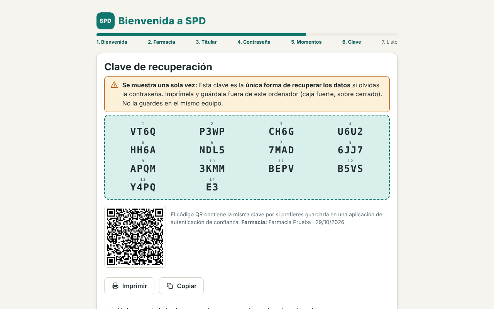
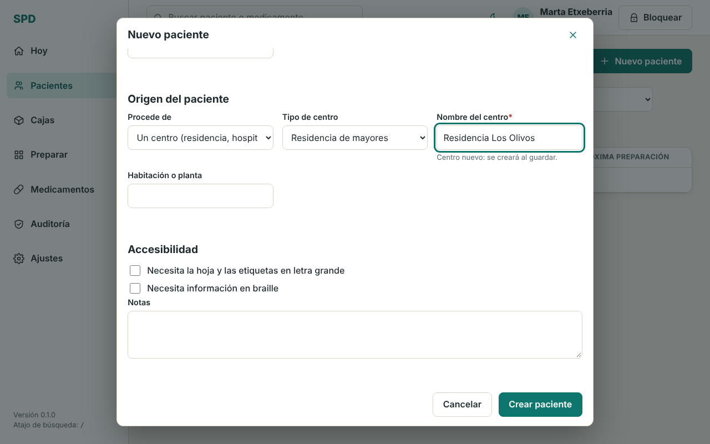
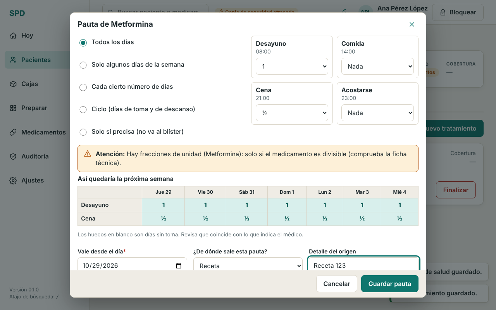
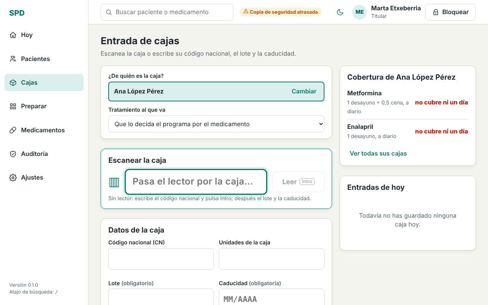
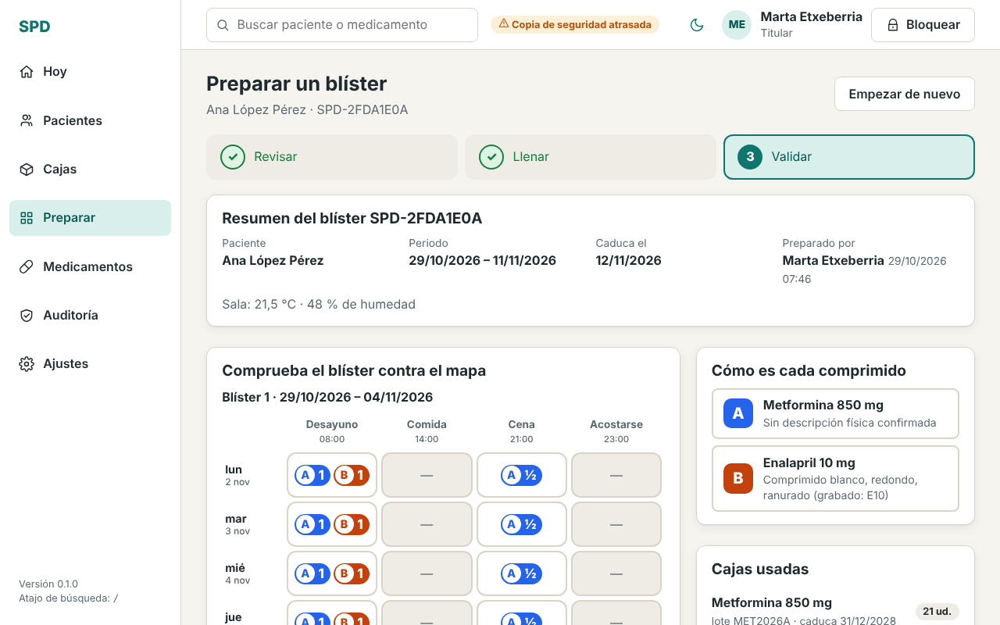
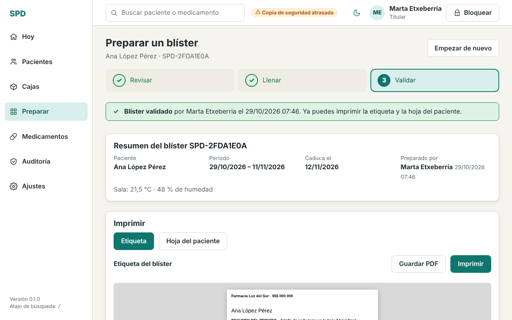
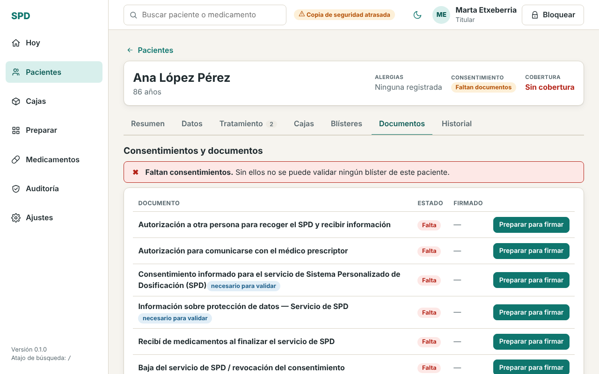
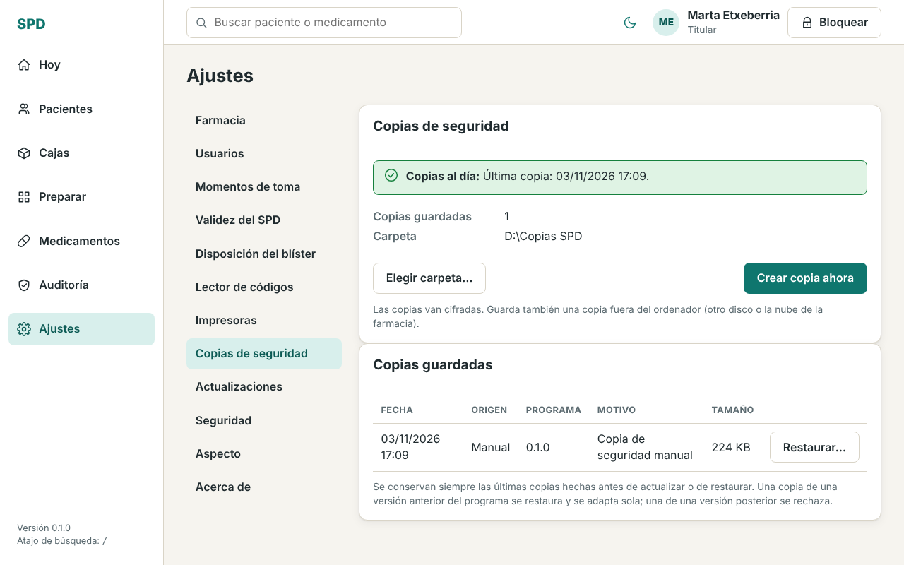
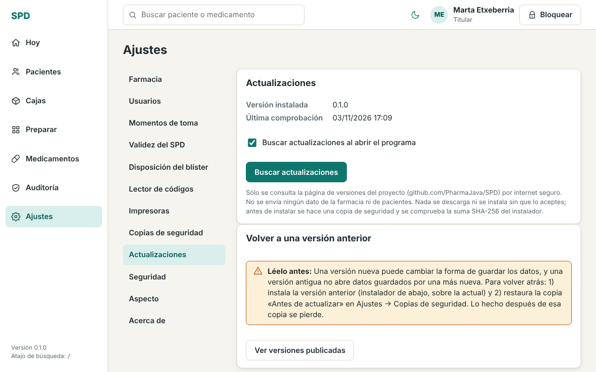
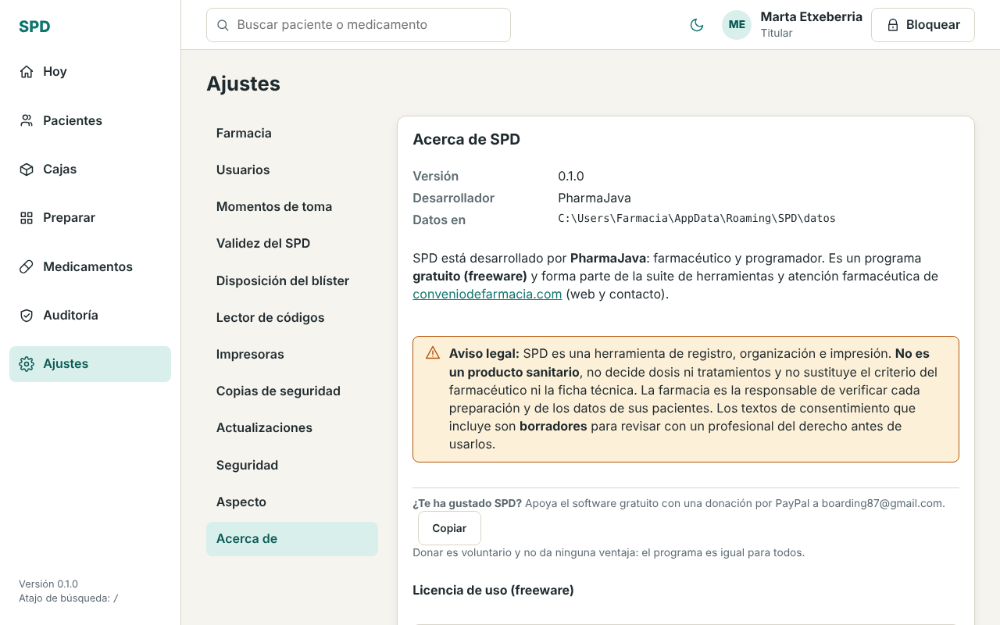

# SPD · Manual de usuario

Guía rápida para el personal de la farmacia. Versión 0.1 · Programa gratuito para Windows.

> **Importante.** SPD organiza, registra e imprime. **No decide dosis ni tratamientos** y no sustituye al farmacéutico ni a la ficha técnica. La farmacia es responsable de comprobar cada preparación y de los datos de sus pacientes.

## 1. Instalar el programa

1. Entra en **https://github.com/PharmaJava/SPD/releases** y descarga el fichero `SPD-Setup-x.y.z.exe` de la versión más reciente.
2. Ábrelo. Como el programa **todavía no está firmado digitalmente**, Windows puede mostrar el aviso azul *«Windows protegió su PC»* (SmartScreen). No es un virus: pulsa **Más información** y después **Ejecutar de todas formas**.
3. Acepta la licencia y sigue el instalador. Al terminar, abre **SPD** desde el escritorio o el menú Inicio.

Junto a cada versión se publica su suma de comprobación (SHA-256) por si quieres verificar el fichero descargado.

## 2. Primer uso: contraseña y clave de recuperación

La primera vez, SPD te guía en siete pasos: bienvenida, datos de la farmacia, datos del titular, **contraseña**, momentos de toma (desayuno, comida, cena…), **clave de recuperación** y final.

- **Contraseña de la farmacia** (mínimo 10 caracteres): protege todos los datos de los pacientes. Elige una frase larga que recuerdes. Se pide al abrir el programa.
- Cada persona del equipo entra además con su **usuario y un PIN** (Ajustes → Usuarios).
- **Clave de recuperación**: se muestra **una sola vez**. Es la **única forma de recuperar los datos** si olvidas la contraseña. **Imprímela y guárdala fuera del ordenador** (caja fuerte, sobre cerrado). Sin contraseña y sin clave, los datos no se pueden abrir: nadie puede ayudarte.

**¿Contraseña obligatoria?** No: la casilla **«Proteger con contraseña (recomendado)»** viene marcada. Si la desmarcas, SPD abre sin pedir nada, con tu usuario de Windows. Los datos siguen cifrados en el disco, pero **cualquier persona que abra Windows con tu usuario podrá abrir SPD y ver los datos de los pacientes**. Seguirás teniendo clave de recuperación. Puedes cambiarlo después en **Ajustes → Seguridad** (solo el titular, con un motivo; antes se hace una copia de seguridad). Si usas SPD en otro equipo o con otro usuario de Windows, hará falta la clave de recuperación.

**PIN y usuarios**: en **Ajustes → Seguridad → PIN y usuarios** el titular puede dejar de pedir el PIN y/o que se elija usuario al arrancar. Aunque no haya PIN, **para validar un blíster hay que elegir a un farmacéutico o al titular y confirmarlo**; la validación queda a su nombre.

Si olvidas la contraseña: en la pantalla de entrada pulsa **«He perdido la contraseña»** y escribe la clave de recuperación.

## 3. Dar de alta a un paciente

Menú **Pacientes → Nuevo paciente**. Obligatorios: nombre y primer apellido. Rellena fecha de nacimiento, tarjeta sanitaria y contacto, y revisa las alergias y datos de salud.

En **«Origen del paciente»** elige:

- **Individual**: vive en su domicilio.
- **Un centro** (residencia, hospital…): escribe el nombre del centro (si ya existe, se reutiliza), su tipo y la habitación o planta. Así puedes filtrar luego a todos los pacientes de una residencia.

Tras crearlo verás su ficha, con avisos de lo que falta («Qué hay que hacer»): consentimientos, tratamientos…

## 4. Medicamentos y pauta

- En **Medicamentos** puedes buscar un medicamento en la **AEMPS (CIMA)** por su código nacional. A CIMA solo viaja el código nacional o el nombre del medicamento, **nunca datos de pacientes**. Lo que viene de CIMA se muestra con su fuente y **tú lo confirmas o lo corriges**. El aspecto del comprimido figura «por completar» hasta que un farmacéutico lo confirma.
- En la ficha del paciente, pestaña **Tratamiento → Nuevo tratamiento**: indica el principio activo y la dosis, y después la **pauta**: qué días (todos, algunos, cada N días, ciclos, «solo si precisa») y cuántas unidades en cada momento del día. La tabla «Así quedaría la próxima semana» te permite comprobarlo antes de guardar.
- Indica **de dónde sale la pauta** (receta, informe…): queda registrado. **Las dosis las introduce o confirma un farmacéutico**; el programa no las inventa.
- Si cambia la pauta, no se borra la anterior: se guarda una nueva versión con quién y cuándo.

## 5. Registrar las cajas

Cada caja que entra se registra en **Cajas** (o desde la ficha del paciente → *Entrada de cajas*):

1. Elige **de quién es la caja** (y, si quieres, a qué tratamiento va).
2. **Escanea el DataMatrix** de la caja con el lector (el cursor ya está en el campo). Si no tienes lector, escribe el código nacional y pulsa Intro.
3. Comprueba el **lote** y la **caducidad**: son **obligatorios**. Si el lector no los trae, escríbelos desde la caja.
4. Guarda. A la derecha ves la **cobertura**: cuántos días cubre ya lo registrado. Si no cubre el periodo, el programa te avisa antes de preparar.

Ante la duda (código ambiguo, lote ilegible) el programa **bloquea y pregunta**: nunca adivina un lote.

## 6. Preparar y validar el SPD

Menú **Preparar** (o «Preparar blíster» en la ficha). Tres pasos:

1. **Revisar**: el programa comprueba consentimientos, cajas y caducidades. Si falta algo, lo indica y no deja continuar.
2. **Llenar**: sigue el orden de llenado e identifica cada caja leyendo su código con el lector. Una caja de otro paciente o caducada se rechaza.
3. **Validar**: la validación la hace **un farmacéutico (o el titular) con su propio usuario**, comparando el blíster con el mapa. Un técnico o administrativo puede preparar pero **no validar**.

La **caducidad del SPD es de 14 días** desde su preparación (ajustable hasta 30 solo si la farmacia lo activa en Ajustes y justifica cada uso). El programa guarda qué lote fue a qué blíster.

## 7. Etiquetas e impresión

Una vez validado el blíster aparecen **Etiqueta** y **Hoja del paciente** (plan de administración en A4):

- Pulsa **Imprimir** o **Guardar como PDF**: el PDF sale con el mismo diseño y tamaño que el papel (etiqueta o A4), elige tú dónde guardarlo (el nombre sugerido lleva apellidos y fecha, nunca el DNI) y sirve para imprimir en otro equipo si fallan las impresoras. Lo mismo vale para la hoja de trabajo y los documentos de la ficha. En Ajustes → *Impresoras* eliges la impresora y puedes imprimir una página de prueba; el tamaño de etiqueta es configurable.
- Si el paciente necesita **letra grande**, márcalo en su ficha y saldrá así.
- Después se registra la **entrega** al paciente o cuidador.

## 8. Documentos y consentimientos

En la ficha del paciente, pestaña **Documentos**, aparecen los documentos del servicio. Pulsa **«Preparar para firmar»**, imprímelo, que lo firme el paciente (o su representante) y marca el documento como firmado.

- Son **obligatorios para validar** el consentimiento informado del servicio y la información de protección de datos. Sin ellos no se puede validar ningún blíster (salvo que el titular lo desactive, ver más abajo).
- Los textos son **genéricos y son borradores: revísalos con un profesional del derecho antes de usarlos** en tu farmacia. El documento impreso no lleva ninguna marca ni aviso del programa: es solo el texto del documento.

### Si la farmacia no quiere exigir los consentimientos

En **Ajustes → Consentimientos** el titular puede desactivar **«Exigir consentimientos firmados para validar»** (por defecto está activado). Pide un motivo escrito y queda en la auditoría. **Si lo desactivas, la farmacia asume la responsabilidad de gestionar los consentimientos fuera del programa.** Los pendientes se siguen mostrando, pero como información (no en rojo) y ya no impiden validar. Puede volver a activarse cuando se quiera.

### Consentimientos que recoge el centro (residencias): «gestionado sin firma individual»

Cuando el consentimiento lo recoge la residencia y no lo firma cada paciente, puedes dejarlo registrado **sin falsear ninguna firma**:

- **Un paciente**: en su pestaña **Documentos**, botón **«Gestionado sin firma»** (junto al documento que falta). Escribe el motivo.
- **Todos los de un centro**: en **Pacientes**, elige el centro en el filtro y pulsa **«Aceptar todo»**. El diálogo te dice cuántos pacientes activos y qué documentos se registrarán, cuántos se saltan (porque ya lo tienen vigente), y pide un **motivo obligatorio** (por ejemplo, «Consentimiento recogido por el centro»).

Solo pueden hacerlo el titular y los farmacéuticos. En cada paciente el documento se ve como **«Gestionado por el centro, sin firma individual»**, con fecha, quién lo registró y el motivo; nunca se muestra ni se imprime como firmado. Se puede **revocar** (queda en el historial), y si más adelante el paciente firma, se registra la firma sustituyendo al registro gestionado. Todo queda en la auditoría. Es una decisión de la farmacia, que asume esa responsabilidad.

### Avisos y notificaciones

- Los mensajes breves que salen abajo a la derecha se cierran **con un clic**. Los de error y atención se cierran solos a los **10 segundos** si no tienes el ratón encima; si el mismo mensaje se repite, no se apila: sale una vez con «×3», por ejemplo. Cuando hay varios, aparece **«Cerrar todas»**.
- En la pantalla **Hoy**, cada aviso que no afecta a la seguridad tiene **«Marcar como visto»** (queda atenuado) y **«Quitar»** (se oculta). **«Quitar todos los vistos»** oculta los ya vistos y **«Mostrar de nuevo»** los recupera. Lo mismo vale para el distintivo «Copia de seguridad atrasada». En este equipo solo se recuerda el *tipo* de aviso general que quitaste, nunca nombres de pacientes.
- Los avisos de **seguridad** (consentimiento exigido que falta, caja caducada, alerta de calidad, alergia sin confirmar) **no se pueden ocultar**.

## 9. Copias de seguridad y restauración

Los datos están **solo en este ordenador**. Una avería o un robo sin copia significa perderlo todo.

**Ajustes → Copias de seguridad**: elige una carpeta (mejor un disco externo o la nube de la farmacia) y pulsa **Crear copia ahora**. Las copias van **cifradas**. Haz una al terminar cada jornada o al menos cada semana; si se atrasa, aparece un aviso arriba.

**Restaurar**: en la lista de copias pulsa **Restaurar…**, escribe la contraseña de la farmacia (si no usas contraseña de arranque, no hace falta) y la palabra **RESTAURAR**. Una copia hecha sin contraseña de arranque solo se abre en el mismo equipo y usuario de Windows; en otro hay que escribir su clave de recuperación. Cuidado: **sustituye todos los datos actuales** y se pierde lo hecho después de la copia (antes se guarda una copia del estado actual por si te arrepientes). Solo el titular puede restaurar.

## 10. Actualizaciones

**Ajustes → Actualizaciones**. El programa comprueba si hay una versión nueva en la página de versiones de GitHub (no envía ningún dato de la farmacia ni de pacientes). **Siempre pregunta antes**: nunca descarga ni instala nada sin que lo aceptes, y nunca se reinicia solo. Antes de instalar hace una **copia de seguridad** y comprueba el instalador. Puedes desactivar la búsqueda al abrir el programa y pulsar **Buscar actualizaciones** cuando te venga bien (no a mitad de una preparación).

## 11. Si algo falla

- **Olvidé la contraseña** → «He perdido la contraseña» + clave de recuperación (punto 2).
- **El lector no escribe el código** → haz clic en el campo «Pasa el lector…» y prueba en *Ajustes → Lector de códigos*. Como alternativa escribe el código nacional, lote y caducidad a mano.
- **No imprime** → *Ajustes → Impresoras*, elige la impresora y pulsa la página de prueba.
- **No me deja validar** → faltan consentimientos, hay una caja caducada o de otro paciente, o el usuario no es farmacéutico.
- **Algo no cuadra tras actualizar** → restaura la copia «Antes de actualizar» (Ajustes → Copias de seguridad).
- **El programa se bloquea solo** → es el bloqueo por inactividad: vuelve a entrar con la contraseña (sin contraseña de arranque, solo vuelve a pedir quién eres).
- **«Windows no ha abierto los datos»** → los datos se crearon sin contraseña con otro usuario de Windows u otro equipo: usa la clave de recuperación.

El historial de todo lo que se hace queda en **Auditoría**. Para dudas o errores escribe a través de **conveniodefarmacia.com**, indicando la versión (Ajustes → Acerca de) y **sin enviar nunca datos de pacientes**.

## 12. Acerca de y donación voluntaria

SPD lo desarrolla **PharmaJava**, farmacéutico y programador. Es un programa **gratuito (freeware)**: la licencia permite usarlo y copiarlo sin cobrar, pero no venderlo ni modificarlo. Más herramientas para farmacia en **https://conveniodefarmacia.com**.

Si te resulta útil, puedes apoyar el proyecto con una **donación voluntaria por PayPal** (boarding87@gmail.com). Donar no da ninguna ventaja: el programa es igual para todos.

